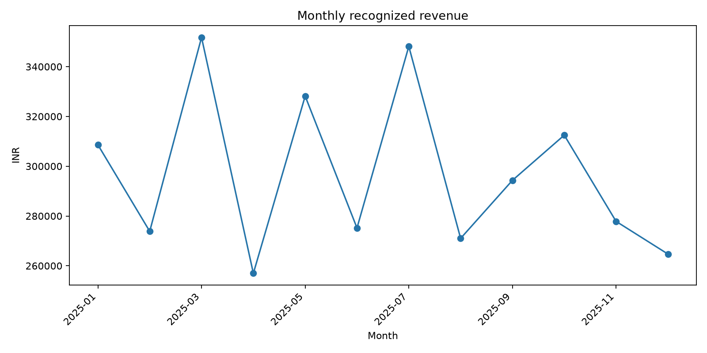

# E-commerce Sales & Customer Analytics



A reproducible **data analytics portfolio project** using Python, Pandas, Matplotlib, MySQL 8+ and optional Power BI. Explore monthly revenue, profit, top products, city performance, customer repeat behavior and order outcomes.

> **Data disclosure:** The included 2,400-row CSV is **synthetic demonstration data**, not actual retail transactions. All monetary values are illustrative INR. Do not present insights as real market findings.

## Repository contents
- `data/orders_raw.csv` — reproducible synthetic sample transactions (2025)
- `data/orders_cleaned.csv` — generated by analysis script
- `data/monthly_summary.csv`, `data/kpi_summary.json` — generated outputs
- `src/analyze.py` — validation, cleaning, KPIs and charts
- `sql/mysql_schema.sql` — MySQL table definition
- `sql/analysis_queries.sql` — nine business analysis queries
- `visualizations/` — four generated PNG charts
- `dashboard/POWER_BI_GUIDE.md` — step-by-step dashboard and DAX instructions
- `docs/INTERVIEW_GUIDE.md` — definitions, caveats, interview practice

## Run on Windows (VS Code / PowerShell)
```powershell
cd ecommerce_sales_analytics
py -m venv .venv
.venv\Scripts\Activate.ps1
pip install -r requirements.txt
python src/analyze.py
```
If PowerShell blocks activation, use `.venv\Scripts\python.exe -m pip install -r requirements.txt` and `.venv\Scripts\python.exe src/analyze.py` instead.

## Run on macOS/Linux
```bash
python3 -m venv .venv
source .venv/bin/activate
pip install -r requirements.txt
python src/analyze.py
```

## SQL setup
1. Run `sql/mysql_schema.sql` in MySQL Workbench (MySQL 8+).
2. Select the `ecommerce_analytics` database; right-click its `orders` table > **Table Data Import Wizard**.
3. Import `data/orders_cleaned.csv` into the **existing** `orders` table, matching columns.
4. Run `sql/analysis_queries.sql` and compare revenue/order totals with `data/kpi_summary.json`.

## Power BI
Follow [Power BI instructions](dashboard/POWER_BI_GUIDE.md). A `.pbix` file is not bundled because it must be built and validated in Power BI Desktop.

## Method and caveats
Each row is one single-product order (not a multi-line order). Net sales account for discounts. Delivered orders alone contribute recognized revenue and profit. Costs omit shipping, taxes, acquisition cost and overhead. Customer IDs are pseudonymous. Synthetic data supports practice, **not evidence of real-world commercial trends**.

## Business questions
1. How does revenue change by month?
2. Which product categories and individual products drive revenue?
3. Which cities and channels perform best?
4. How many customers order more than once?
5. What proportion of orders are returned or cancelled?

## Learning and attribution
This is a starter project assembled with AI assistance. Run and inspect the code, validate the outputs, and make your own changes before describing it as independently developed.
